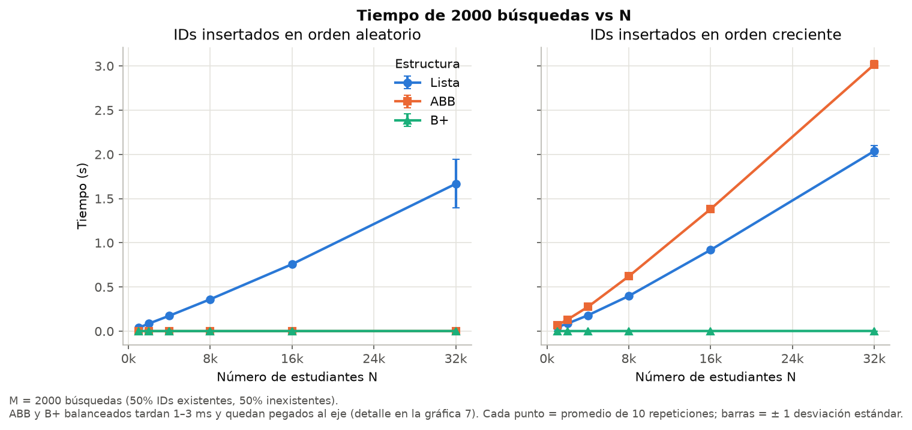
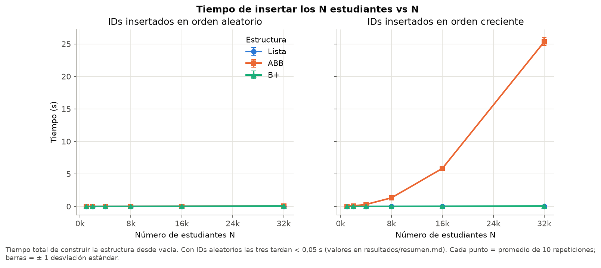
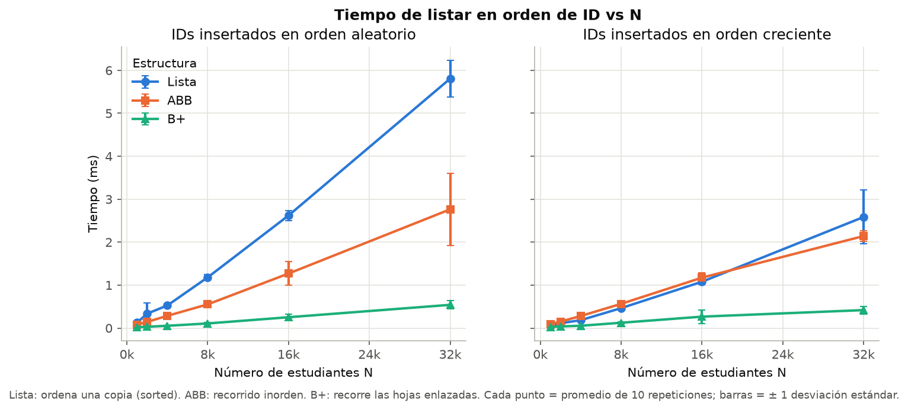
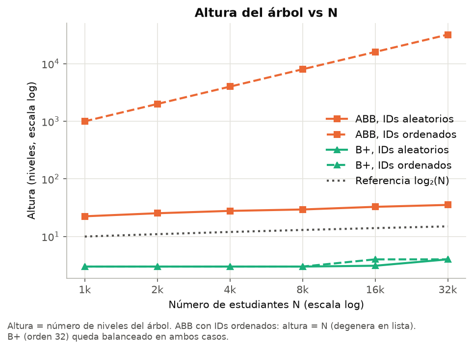
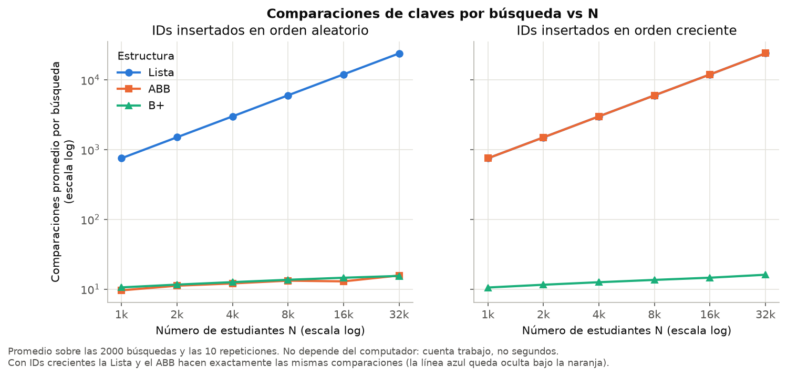
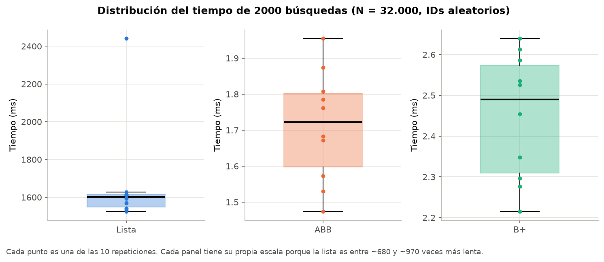
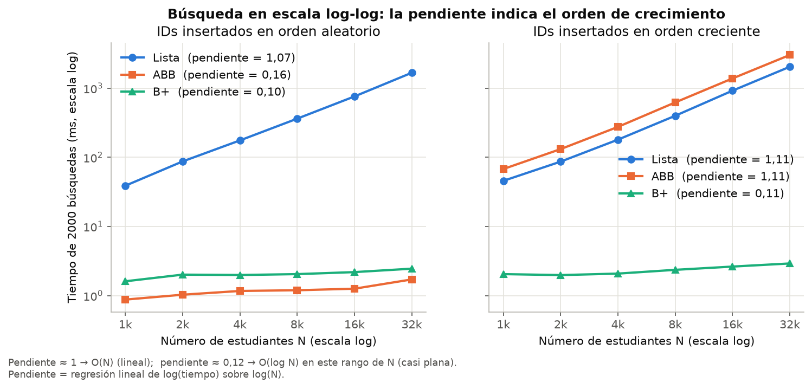

# Informe — Laboratorio 3: Sistema de búsqueda de estudiantes

**Estudio experimental de escalabilidad de Lista, Árbol Binario de Búsqueda (ABB) y Árbol B+**

| | |
|---|---|
| Estudiante | Karelyn Caicedo Velez |
| Universidad | Universidad de Antioquia |
| Curso | Estructuras de Datos |
| Fecha de sustentación | 13 de octubre de 2026 |

> Todos los números de este informe salen de `resultados/mediciones.csv` (360 mediciones crudas)
> y de `resultados/resumen.md`. Las figuras están en `graficas/`. El detalle de cómo reproducir el
> experimento está en el [README](README.md).

---

## Resumen

Se implementaron tres estructuras para almacenar estudiantes (una lista no ordenada, un ABB sin
balanceo y un árbol B+ de orden 32) y se midió el tiempo de **insertar** N estudiantes, hacer
**M = 2.000 búsquedas** y **listar** en orden de ID, para N = 1.000, 2.000, 4.000, 8.000, 16.000 y
32.000, con IDs insertados en orden **aleatorio** y en orden **creciente**, 10 repeticiones por punto.

Los resultados coinciden con la complejidad teórica. La búsqueda en la lista crece linealmente
(pendiente log-log ≈ 1,07–1,11) y los árboles balanceados crecen de forma logarítmica (pendiente
≈ 0,10–0,16). Con N = 32.000 la lista es entre 680 y 970 veces más lenta que los árboles. Cuando
los IDs llegan ordenados, el ABB degenera en una lista (altura = N): su búsqueda pasa a O(N) y su
construcción a O(N²) (pendiente 2,09; 25,3 s para N = 32.000). El B+ no se ve afectado por el
orden de inserción: su altura se mantiene en 3–4 niveles en todos los casos.

---

## 1. Introducción

### 1.1 Problema

Una institución necesita administrar registros de estudiantes con `id` (matrícula única),
`nombre`, `edad` y `promedio`, y permitir tres operaciones:

1. Buscar un estudiante por su ID.
2. Insertar un estudiante nuevo.
3. Listar todos los estudiantes en orden ascendente de ID.

### 1.2 Objetivo

Estudiar experimentalmente cómo la estrategia de almacenamiento y búsqueda afecta el tiempo de
ejecución a medida que crece el número de estudiantes N, y comprobar si el crecimiento observado
corresponde a la complejidad teórica de cada estructura.

### 1.3 Preguntas que se responden

- ¿Los resultados se comportan como predice la complejidad teórica?
- ¿En qué situaciones el ABB deja de comportarse como O(log N)?
- ¿Qué relación existe entre la altura del árbol y el tiempo de búsqueda?
- ¿Qué ocurre cuando los datos se insertan ordenadamente, y qué diferencias hay con el caso aleatorio?
- ¿A partir de qué N se ven claramente las diferencias?
- ¿Hay costos constantes que hagan que algoritmos de distinta complejidad tarden lo mismo con N pequeño?

---

## 2. Marco teórico

| Operación | Lista no ordenada | ABB (IDs aleatorios) | ABB (IDs ordenados) | Árbol B+ |
|---|---|---|---|---|
| Buscar uno | O(N) | O(log N) en promedio | O(N) | O(log N) |
| Insertar uno | O(1) | O(log N) en promedio | O(N) | O(log N) |
| Construir con N | O(N) | O(N log N) | O(N²) | O(N log N) |
| Listar en orden | O(N log N) (ordena una copia) | O(N) (inorden) | O(N) | O(N) (hojas enlazadas) |
| Altura | — | ≈ c·log N | N | O(log N), con base grande porque cada nodo tiene hasta 32 hijos (3–4 niveles aquí) |

**Lista.** No guarda ningún orden; para buscar hay que revisar los elementos uno por uno. Si el
ID no existe, se recorre la lista completa.

**ABB.** Cada nodo tiene a la izquierda los IDs menores y a la derecha los mayores. Buscar o
insertar baja un nivel por comparación, así que el costo es proporcional a la **altura** h. Con
IDs aleatorios h crece como log N, pero el ABB **no se balancea**: si los IDs llegan en orden
creciente, cada nodo nuevo queda como hijo derecho del anterior y h = N.

**Árbol B+.** Es un árbol de búsqueda con muchos hijos por nodo (aquí hasta 32). Los registros
están solo en las hojas, y las hojas están enlazadas entre sí. Cuando un nodo se llena se divide
en dos y una clave sube al padre; el árbol crece desde la raíz, por lo que **todas las hojas
quedan siempre a la misma profundidad**, sin importar el orden de inserción.

**Cómo reconocer la complejidad en los datos.** Si el tiempo se comporta como t = c·N^b, al tomar
logaritmos queda log t = log c + b·log N, que es una recta de pendiente b. Una regresión lineal
de log(t) sobre log(N) estima b. Para el rango usado (N de 1.000 a 32.000), los valores de
referencia que se deben esperar son:

| Crecimiento teórico | Pendiente esperada en este rango |
|---|---:|
| O(log N) | **0,12** |
| O(N) | 1,00 |
| O(N log N) | **1,12** |
| O(N²) | 2,00 |

Estos valores se obtienen aplicando la misma regresión a las funciones log₂N, N, N·log₂N y N² en
los seis valores de N del experimento. Es importante notar que **O(log N) no da pendiente 0**,
sino ≈ 0,12, y O(N log N) no da 1, sino ≈ 1,12.

---

## 3. Implementación

| Archivo | Contenido |
|---|---|
| `estudiante.py` | Clase `Estudiante` (id, nombre, edad, promedio). |
| `lista.py` | Lista de Python no ordenada: `append` para insertar, recorrido secuencial para buscar, `sorted` para listar. No revisa duplicados (eso haría la inserción O(N)). |
| `abb.py` | ABB sin balanceo, **iterativo** (con IDs ordenados la altura llega a 32.000 y una versión recursiva superaría el límite de recursión de Python). Rechaza IDs duplicados. |
| `arbol_bmas.py` | Árbol B+ de orden 32 (máximo 32 hijos por nodo interno, 31 claves por hoja), hojas enlazadas, búsqueda binaria dentro de cada nodo. Rechaza IDs duplicados. |
| `test_estructuras.py` | Pruebas de corrección. |
| `experimento.py` | Genera los datos, mide los tiempos y guarda `resultados/mediciones.csv`. |
| `graficas.py` | Calcula las estadísticas y dibuja las gráficas a partir del CSV. |

Cada estructura cuenta, además, las **comparaciones de claves** que hace `buscar()` y reporta su
**altura**. Estas dos medidas no dependen del computador y sirven para comprobar la teoría sin el
ruido del reloj.

**Corrección.** `test_estructuras.py` inserta IDs en orden aleatorio, creciente y decreciente
(N = 1, 2, 10, 1.000 y 5.000; B+ de orden 3, 4 y 32), busca todos los IDs y algunos inexistentes,
verifica que el listado salga ordenado, que no se acepten duplicados, que el ABB con IDs ordenados
tenga altura N y que el B+ quede balanceado. Todas las pruebas pasan.

---

## 4. Metodología experimental

### 4.1 Parámetros

| Parámetro | Valor | Justificación |
|---|---|---|
| Tamaños de entrada N | 1.000, 2.000, 4.000, 8.000, 16.000, 32.000 | N se duplica en cada paso: si el tiempo se duplica es O(N), si se multiplica por 4 es O(N²), si casi no cambia es O(log N). Seis puntos permiten ajustar una pendiente. |
| Número de búsquedas M | 2.000 por repetición | 1.000 IDs que existen y 1.000 que no existen. |
| Repeticiones | 10 por cada combinación (orden, N) | Permiten calcular media, desviación estándar y mediana. |
| Orden de inserción | aleatorio y creciente | El orden creciente es el peor caso del ABB. |
| Orden del B+ | 32 | Valor típico para un B+ en memoria. |
| Semilla | 2026 | Hace reproducibles los datos y las búsquedas. |
| Total de mediciones | 2 órdenes × 6 N × 10 repeticiones × 3 estructuras = **360** | |

**Selección del N máximo.** Se buscó que los casos lentos quedaran entre 1 segundo y 5 minutos.
Con N = 32.000, las búsquedas en la lista tardan 1,7–2,0 s, en el ABB degenerado 3,0 s, y construir
el ABB con IDs ordenados tarda 25 s por repetición. Como esa construcción es O(N²), con N = 64.000
tardaría unos 110 s por repetición (≈ 18 minutos solo para ese punto), lo que hace impráctico
seguir duplicando. Los árboles balanceados se quedan en milisegundos en todo el rango, y eso es
precisamente lo que el experimento quiere mostrar.

**Selección de M.** Con M = 100, buscar en la lista con N = 32.000 tardaría
solo ≈ 0,08–0,10 s, por debajo del objetivo de 1 s, y las 100 búsquedas en el ABB aleatorio
tardarían ≈ 0,09 ms, una medida tan corta que la dominaría el ruido del sistema operativo. Con
M = 2.000 la lista pasa de 1 s y los árboles quedan en milisegundos medibles. M se mantuvo fijo
porque cada búsqueda es independiente de las demás: el tiempo total crece proporcional a M
(M veces el costo de una búsqueda), así que cambiar M solo multiplica todas las curvas por la
misma constante y no cambia las pendientes ni la comparación entre estructuras.

### 4.2 Generación de los datos

- N IDs únicos tomados al azar del intervalo [1, 10N) con `random.sample`.
- Caso "creciente": la misma muestra de IDs, ordenada de menor a mayor.
- Edad aleatoria entre 16 y 30, promedio aleatorio entre 0 y 5, nombre `"Estudiante<ID>"`.

### 4.3 Generación de las búsquedas

- 1.000 IDs escogidos al azar entre los que existen.
- 1.000 IDs en el intervalo [10N, 20N), que con seguridad **no existen** (peor caso de la lista).
- Las 2.000 consultas se mezclan al azar.
- Dentro de cada repetición, **las tres estructuras reciben los mismos estudiantes en el mismo
  orden y las mismas búsquedas**, así la comparación entre ellas es justa.

### 4.4 Medición de los tiempos

- Reloj: `time.perf_counter()` (alta resolución y monotónico).
- Se cronometra solo la operación; la generación de datos queda fuera.
- Se mide el **bloque completo** (las N inserciones, las M búsquedas, un listado), no cada
  operación por separado, para que la resolución del reloj no afecte las medidas cortas.
- El listado se guarda en memoria, no se imprime (imprimir dominaría el tiempo).
- El recolector de basura se ejecuta antes de cada medición y se desactiva durante ella.
- Se hace una corrida de calentamiento (N = 1.000) que se descarta.
- El orden en que se miden las tres estructuras se cambia al azar en cada repetición, para que
  ninguna tenga siempre la ventaja o desventaja de ir primero.

### 4.5 Tratamiento de valores atípicos

No se eliminó ningún dato. Con solo 10 repeticiones, quitar puntos cambiaría mucho la media. En
su lugar se reporta la **mediana** junto a la media y se muestra la distribución completa en un
diagrama de caja (figura 6).

### 4.6 Estadísticas utilizadas

- **Media** de las 10 repeticiones: es el punto que se dibuja en las gráficas.
- **Desviación estándar muestral**: las barras de error (± 1 desviación).
- **Mediana**: valor central, resistente a atípicos.
- **Coeficiente de variación** (CV = desviación / media): permite comparar la dispersión entre
  medidas de tamaños muy distintos.
- **Pendiente log-log**: regresión lineal de log(tiempo medio) sobre log(N), para estimar el
  exponente de crecimiento (sección 2).
- **Costo por comparación**: tiempo de búsqueda / (M × comparaciones por búsqueda).

### 4.7 Hardware y software

| | |
|---|---|
| Procesador | Intel Core i7-1255U (12.ª generación), 10 núcleos / 12 hilos, 1,7 GHz base |
| Memoria | 16 GB RAM |
| Sistema operativo | Windows 11 Home Single Language (10.0.26200) |
| Lenguaje | Python 3.13.3 (CPython, 64 bits), un solo hilo |
| Librerías | Solo biblioteca estándar para el experimento; `matplotlib` para las gráficas |
| Condiciones | Portátil conectado a la corriente, modo de energía "Máximo rendimiento", OneDrive, pgAdmin y demás aplicaciones cerradas, sin Colab ni notebooks |
| Duración total | ≈ 7,6 minutos (15:23 a 15:31 del 11/10/2026) |

---

## 5. Resultados

Valores: **media ± desviación estándar** de 10 repeticiones, en **milisegundos**.

### 5.1 Tiempo de M = 2.000 búsquedas (ms)

| Orden | Estructura | N = 1.000 | N = 2.000 | N = 4.000 | N = 8.000 | N = 16.000 | N = 32.000 |
|---|---|---:|---:|---:|---:|---:|---:|
| aleatorio | Lista | 38,77 ± 1,50 | 87,05 ± 9,79 | 175,26 ± 15,34 | 361,67 ± 13,22 | 758,36 ± 21,05 | 1666,89 ± 274,57 |
| aleatorio | ABB | 0,87 ± 0,20 | 1,03 ± 0,22 | 1,17 ± 0,09 | 1,19 ± 0,16 | 1,26 ± 0,07 | 1,71 ± 0,15 |
| aleatorio | B+ | 1,61 ± 0,11 | 2,01 ± 0,56 | 1,98 ± 0,41 | 2,04 ± 0,13 | 2,18 ± 0,10 | 2,45 ± 0,15 |
| creciente | Lista | 45,65 ± 7,62 | 86,56 ± 4,47 | 179,90 ± 4,74 | 398,44 ± 6,81 | 919,36 ± 12,05 | 2037,41 ± 61,86 |
| creciente | ABB | 67,66 ± 8,34 | 131,43 ± 3,71 | 275,25 ± 4,90 | 621,45 ± 13,69 | 1381,46 ± 27,61 | 3015,88 ± 42,41 |
| creciente | B+ | 2,04 ± 0,66 | 1,98 ± 0,09 | 2,08 ± 0,09 | 2,36 ± 0,32 | 2,63 ± 0,22 | 2,91 ± 0,11 |

### 5.2 Tiempo de insertar los N estudiantes (ms)

| Orden | Estructura | N = 1.000 | N = 2.000 | N = 4.000 | N = 8.000 | N = 16.000 | N = 32.000 |
|---|---|---:|---:|---:|---:|---:|---:|
| aleatorio | Lista | 0,04 ± 0,01 | 0,08 ± 0,00 | 0,14 ± 0,01 | 0,25 ± 0,01 | 0,52 ± 0,03 | 1,07 ± 0,10 |
| aleatorio | ABB | 0,51 ± 0,03 | 1,13 ± 0,11 | 2,71 ± 0,28 | 5,42 ± 0,36 | 12,71 ± 0,51 | 31,11 ± 1,37 |
| aleatorio | B+ | 0,98 ± 0,25 | 2,04 ± 0,26 | 4,43 ± 0,20 | 9,17 ± 0,29 | 20,43 ± 0,36 | 47,63 ± 1,49 |
| creciente | Lista | 0,06 ± 0,02 | 0,08 ± 0,00 | 0,16 ± 0,01 | 0,30 ± 0,02 | 0,58 ± 0,06 | 1,13 ± 0,09 |
| creciente | ABB | 18,40 ± 1,12 | 72,83 ± 2,20 | 298,21 ± 3,30 | 1318,84 ± 23,06 | 5845,59 ± 41,20 | 25331,57 ± 599,76 |
| creciente | B+ | 1,09 ± 0,34 | 2,04 ± 0,09 | 4,54 ± 0,29 | 9,54 ± 0,27 | 21,87 ± 1,07 | 49,21 ± 2,50 |

### 5.3 Tiempo de listar en orden de ID (ms)

| Orden | Estructura | N = 1.000 | N = 2.000 | N = 4.000 | N = 8.000 | N = 16.000 | N = 32.000 |
|---|---|---:|---:|---:|---:|---:|---:|
| aleatorio | Lista | 0,12 ± 0,01 | 0,34 ± 0,25 | 0,53 ± 0,03 | 1,18 ± 0,06 | 2,62 ± 0,12 | 5,81 ± 0,43 |
| aleatorio | ABB | 0,08 ± 0,01 | 0,14 ± 0,01 | 0,28 ± 0,02 | 0,55 ± 0,05 | 1,27 ± 0,28 | 2,76 ± 0,84 |
| aleatorio | B+ | 0,02 ± 0,00 | 0,03 ± 0,00 | 0,05 ± 0,01 | 0,11 ± 0,02 | 0,25 ± 0,06 | 0,54 ± 0,09 |
| creciente | Lista | 0,05 ± 0,01 | 0,11 ± 0,08 | 0,18 ± 0,01 | 0,46 ± 0,04 | 1,08 ± 0,06 | 2,59 ± 0,63 |
| creciente | ABB | 0,09 ± 0,02 | 0,15 ± 0,01 | 0,28 ± 0,02 | 0,56 ± 0,04 | 1,17 ± 0,11 | 2,14 ± 0,12 |
| creciente | B+ | 0,03 ± 0,01 | 0,04 ± 0,01 | 0,05 ± 0,01 | 0,12 ± 0,02 | 0,27 ± 0,16 | 0,42 ± 0,09 |

### 5.4 Comparaciones por búsqueda y altura (N = 32.000)

| Orden | Estructura | Comparaciones / búsqueda | Altura |
|---|---|---:|---:|
| aleatorio | Lista | 23.975 | — |
| aleatorio | ABB | 15,7 | 35 |
| aleatorio | B+ | 15,4 | 4 |
| creciente | Lista | 24.082 | — |
| creciente | ABB | 24.082 | **32.000** |
| creciente | B+ | 16,1 | 4 |

### 5.5 Pendientes log-log (exponente b en tiempo ∝ N^b)

| Orden | Estructura | Insertar N | Buscar M | Listar |
|---|---|---:|---:|---:|
| aleatorio | Lista | 0,92 | **1,07** | 1,08 |
| aleatorio | ABB | 1,18 | **0,16** | 1,03 |
| aleatorio | B+ | 1,12 | **0,10** | 0,96 |
| creciente | Lista | 0,89 | **1,11** | 1,11 |
| creciente | ABB | **2,09** | **1,11** | 0,94 |
| creciente | B+ | 1,11 | **0,11** | 0,85 |

### 5.6 Figuras

En todas las figuras: Lista = azul (●), ABB = naranja (■), B+ = verde (▲). Cada punto es el
promedio de 10 repeticiones y las barras son ± 1 desviación estándar.

**Figura 1.** Tiempo de 2.000 búsquedas vs N. La lista crece en línea recta; con IDs crecientes el
ABB crece igual (y por encima de la lista); los árboles balanceados quedan pegados al eje.



**Figura 2.** Tiempo de construir la estructura con N estudiantes. Solo el ABB con IDs crecientes
se separa, con forma de parábola (O(N²)).



**Figura 3.** Tiempo de listar en orden de ID. Las tres crecen de forma aproximadamente lineal; el
B+ es el más rápido.



**Figura 4.** Altura del ABB y del B+ vs N (escala logarítmica), con log₂(N) como referencia.



**Figura 5.** Comparaciones por búsqueda vs N. Muestra lo mismo que la figura 1 pero contando
trabajo en lugar de segundos, por lo que no depende del computador.



**Figura 6.** Distribución de las 10 repeticiones de la búsqueda para N = 32.000 con IDs aleatorios.



**Figura 7.** Búsqueda en escala log-log, con la pendiente de cada curva.



---

## 6. Análisis

### 6.1 ¿Los resultados se comportan como predice la complejidad teórica?

Sí. Comparando las pendientes medidas (tabla 5.5) con las esperadas (sección 2):

| Caso | Teoría | Pendiente esperada | Pendiente medida |
|---|---|---:|---:|
| Buscar en la lista | O(N) | 1,00 | 1,07 / 1,11 |
| Buscar en ABB aleatorio | O(log N) | 0,12 | 0,16 |
| Buscar en B+ | O(log N) | 0,12 | 0,10 / 0,11 |
| Buscar en ABB creciente | O(N) | 1,00 | 1,11 |
| Construir ABB aleatorio / B+ | O(N log N) | 1,12 | 1,18 / 1,11–1,12 |
| Construir ABB creciente | O(N²) | 2,00 | 2,09 |
| Construir la lista | O(N) | 1,00 | 0,89 / 0,92 |

La regla de la duplicación también se cumple: en la búsqueda de la lista (aleatorio), cada vez que N
se duplica el tiempo se multiplica por 2,25; 2,01; 2,06; 2,10 y 2,20 (≈ 2 → lineal). En la
construcción del ABB con IDs crecientes, por 3,96; 4,09; 4,42; 4,43 y 4,33 (≈ 4 → cuadrático).

La pendiente de construir la lista (0,89–0,92) sale algo menor que 1 porque con N pequeño el
tiempo total es de apenas ≈ 0,04 ms y pesan los costos fijos de la medición (llamar la función,
leer el reloj, reservar memoria): el costo por estudiante baja de ≈ 43–55 ns con N = 1.000 a
≈ 33–35 ns con N = 32.000, donde ya se estabiliza. Es un efecto de costo constante, no un
crecimiento sublineal.

Las **comparaciones** confirman lo mismo sin depender del reloj:

- En la lista, las comparaciones por búsqueda son ≈ 0,75·N (23.975 con N = 32.000). Es lo
  esperado: la mitad de las búsquedas existe y recorre en promedio N/2 elementos, y la otra mitad
  no existe y recorre N. Promedio: (N/2 + N)/2 = 0,75·N.
- En el ABB aleatorio, la teoría de los ABB construidos con claves aleatorias dice que una
  búsqueda exitosa hace en promedio 2(1 + 1/N)·H_N − 3 comparaciones (H_N = 1 + 1/2 + … + 1/N
  ≈ ln N), y una búsqueda de un ID mayor que todos recorre la rama derecha, que mide en promedio
  H_N nodos. Con 50 % de cada tipo, el valor esperado y el medido son:

| N | 1.000 | 2.000 | 4.000 | 8.000 | 16.000 | 32.000 |
|---|---:|---:|---:|---:|---:|---:|
| Comparaciones esperadas | 9,7 | 10,8 | 11,8 | 12,8 | 13,9 | 14,9 |
| Comparaciones medidas | 9,6 | 11,2 | 12,1 | 13,2 | 12,9 | 15,7 |

  La diferencia es de ±1 comparación, que es la variación normal entre árboles aleatorios distintos
  (por ejemplo, con N = 16.000 el valor medido bajó respecto a N = 8.000 porque la rama derecha de
  esos árboles salió más corta).

- En el B+ las comparaciones suben de 10,6 a 15,4. Cada nivel hace una búsqueda binaria dentro de
  su nodo (≈ log₂ del tamaño del nodo), y al sumar todos los niveles el total queda ≈ log₂ N + 1
  (11,0 esperado vs 10,6 medido con N = 1.000; 16,0 vs 15,4 con N = 32.000).

### 6.2 ¿En qué situaciones el ABB deja de comportarse como O(log N)?

Cuando los IDs llegan ordenados (y lo mismo pasaría con IDs decrecientes o casi ordenados). Cada
estudiante nuevo es mayor que todos los anteriores, así que siempre queda como hijo derecho del
último: el árbol se convierte en una "lista inclinada" de altura N (figura 4). Entonces:

- La búsqueda pasa de pendiente 0,16 a 1,11 → O(N) (figura 7).
- Insertar uno pasa a O(N), y construir el árbol completo a O(N²) → pendiente 2,09 (figura 2).

### 6.3 ¿Qué relación existe entre la altura del árbol y el tiempo de búsqueda?

La búsqueda baja exactamente un nivel por comparación, así que el número de comparaciones está
acotado por la altura, y el tiempo es aproximadamente comparaciones × costo de cada comparación.
Ese costo se mantiene casi constante dentro de cada estructura (≈ 26–42 ns en la lista, ≈ 44–63 ns
en el ABB, ≈ 75–97 ns en el B+). Por eso:

- ABB aleatorio: altura 22 → 35; tiempo 0,87 → 1,71 ms.
- B+: altura 3 → 4; tiempo 1,6 → 2,5 ms.
- ABB creciente: altura = N; tiempo crece como la lista y hace **exactamente las mismas**
  comparaciones que ella (24.082 con N = 32.000).

La altura del ABB aleatorio fue ≈ 2,3 × log₂ N, mayor que log₂ N, porque un ABB aleatorio no es
perfectamente balanceado; aun así crece de forma logarítmica.

### 6.4 ¿Qué ocurre cuando los datos se insertan ordenadamente? ¿Qué diferencias hay con el caso aleatorio?

- **ABB:** es la única estructura que cambia de forma importante. Construir el árbol con
  N = 32.000 tarda 25,3 s contra 0,031 s con IDs aleatorios (≈ 800 veces más), y buscar tarda
  3,02 s contra 1,71 ms (≈ 1.760 veces más).
- **El ABB degenerado es incluso más lento que la lista** (3,02 s vs 2,04 s) aunque hace las mismas
  comparaciones. La razón es el costo de cada paso: el ABB sigue punteros a nodos dispersos en
  memoria (≈ 63 ns por comparación), mientras que la lista recorre un arreglo contiguo (≈ 42 ns).
- **B+:** prácticamente igual en los dos casos (altura 3–4, búsqueda 2,4 vs 2,9 ms con N = 32.000).
  Esto muestra para qué sirven los árboles balanceados: garantizan O(log N) sin importar el orden
  de los datos.
- **Lista:** no depende del orden. Solo el listado se vuelve ≈ 2 veces más rápido (2,6 ms vs 5,8 ms),
  porque el algoritmo de ordenamiento de Python (Timsort) detecta que los datos ya vienen ordenados
  y trabaja en tiempo lineal.

### 6.5 ¿A partir de qué N se ven claramente las diferencias?

- **Lista vs árboles balanceados:** desde el N más pequeño. Con N = 1.000 la lista ya es 24 veces
  más lenta que el B+ y 44 veces más lenta que el ABB (38,8 ms vs 1,6 y 0,9 ms). Con N = 32.000 la
  diferencia llega a 680 y 974 veces.
- **ABB aleatorio vs ABB creciente:** ya con N = 1.000 la búsqueda es ≈ 77 veces más lenta en el ABB
  degenerado. En tiempo absoluto se vuelve perceptible (más de medio segundo) desde N ≈ 8.000:
  0,62 s de búsqueda y 1,3 s de construcción.
- **ABB aleatorio vs B+:** no se separan en este rango; los dos son O(log N) y sus curvas son casi
  paralelas.

### 6.6 ¿Hay costos constantes que igualen algoritmos de distinta complejidad para N pequeño?

Sí, en varios casos:

- **ABB degenerado vs lista con N = 1.000:** tardan lo mismo en orden de magnitud (68 ms vs 46 ms),
  aunque son estructuras muy distintas.
- **ABB aleatorio vs B+:** el ABB es algo más rápido (1,7 vs 2,4 ms con N = 32.000) aunque hacen casi
  las mismas comparaciones (15,7 vs 15,4). El B+ paga más por cada comparación (búsqueda binaria
  dentro del nodo, manejo de listas internas y divisiones). Ambos son O(log N); la ventaja del B+ no
  es la velocidad en memoria sino la **garantía** frente a cualquier orden y su **altura mucho
  menor** (4 vs 35), que en disco significa muchos menos accesos.
- **Inserción:** la lista (`append`) es más rápida que los árboles, que crean un nodo y bajan por el
  árbol: ≈ 12–23 veces con N = 1.000 y ≈ 30–45 veces con N = 32.000 (IDs aleatorios). Si hubiera muchas inserciones y muy pocas búsquedas, con N pequeño la lista
  podría ser suficiente.

### 6.7 Calidad de las mediciones

- Las medidas largas (> 0,1 s) tienen CV de 1–5 % en su mayoría (máximo 16 %), lo que indica
  mediciones estables.
- Las medidas de menos de 0,1 s tienen CV más alto (típico de 4–26 %, mediana 8 %, y en tres
  listados de menos de 0,4 ms llega a 60–76 %), porque cualquier interrupción del
  sistema operativo pesa mucho en una medida tan corta. Esto no afecta las conclusiones, ya que
  esas diferencias son de fracciones de milisegundo.
- **Valor atípico identificado:** en la búsqueda de la lista con N = 32.000 (IDs aleatorios), una de
  las 10 repeticiones tardó 2,44 s mientras las otras nueve estuvieron entre 1,52 y 1,63 s (figura 6).
  Por eso la media (1,67 s) es mayor que la mediana (1,60 s) y la desviación es alta (0,27 s; CV 16 %).
  Sin ese punto la media sería 1,58 ± 0,04 s. Se decidió no eliminarlo (sección 4.5), y la pendiente
  de 1,07 no depende de él: la regla de duplicación muestra ≈ ×2 en todos los pasos.

---

## 7. Conclusiones

1. La búsqueda en la lista escala linealmente (O(N)) y en los árboles balanceados de forma
   logarítmica (O(log N)); las pendientes medidas (≈ 1,1 y ≈ 0,1–0,16) coinciden con las esperadas
   para este rango (1,00 y 0,12). La diferencia va de 24–44 veces con 1.000 estudiantes a 680–974
   veces con 32.000.
2. El rendimiento del ABB depende del orden de los datos. Con IDs ordenados se comporta como una
   lista (altura = N), con un costo por paso aún mayor, y construirlo cuesta O(N²).
3. El B+ mantiene altura 3–4 y tiempos de milisegundos en todos los casos. Es la opción más robusta
   y además la más rápida para listar, gracias a sus hojas enlazadas.
4. La altura del árbol explica el tiempo de búsqueda: comparaciones ≈ profundidad recorrida, y
   tiempo ≈ comparaciones × costo constante de cada estructura. Las comparaciones medidas en el ABB
   aleatorio coinciden con el valor teórico esperado con un error de ±1.
5. Los costos constantes importan para N pequeño y entre estructuras de la misma complejidad (ABB
   vs B+ en memoria), pero no cambian el orden de crecimiento.

### Lo que **no** se puede concluir con estos datos

- Que el ABB sea "mejor" que el B+: solo fue un poco más rápido en el caso aleatorio y en memoria.
- Tiempos absolutos para otro lenguaje u otro computador: lo comparable son las pendientes.
- Que el listado de la lista sea O(N log N) a partir de los datos: en este rango no se distingue de
  O(N) (la pendiente esperada sería 1,12 y se midió 1,08–1,11, una diferencia del orden del ruido).

---

## 8. Limitaciones

- Se midió en Python, donde cada comparación cuesta ≈ 25–100 ns, mucho más que en C o Java.
- Portátil con Windows: la frecuencia del procesador cambia (turbo y ahorro de energía) y hay
  procesos en segundo plano que no se controlan del todo.
- N máximo de 32.000, limitado por el costo O(N²) del ABB degenerado.
- Las búsquedas fallidas usan IDs mayores que todos los existentes; en el ABB recorren la rama
  derecha, que es más corta que el promedio. Buscar IDs inexistentes "en los huecos" daría algo
  más de comparaciones en los árboles. Para la lista no hay diferencia.
- 10 repeticiones dan una buena estimación de la media, pero no alcanzan para pruebas de hipótesis
  finas.
- No se midieron inserciones casi ordenadas ni IDs decrecientes (sí se probaron en las pruebas de
  corrección).

---

## 9. Reproducibilidad

```bash
pip install -r requirements.txt
python test_estructuras.py   # pruebas de corrección (~5–10 s)
python experimento.py        # experimento completo (~8 min) -> resultados/mediciones.csv
python graficas.py           # gráficas y resumen a partir del CSV (~10 s)
```

Con la semilla 2026 se generan los mismos datos y las mismas búsquedas; los tiempos variarán según
el equipo, pero las pendientes deben ser las mismas. Las gráficas se pueden regenerar sin repetir
el experimento, porque `graficas.py` solo lee el CSV.

---

## 10. Uso de herramientas de inteligencia artificial

Se usó Claude para generar y corregir el código, sugerir la metodología estadística y
ayudar a redactar el README y este informe, como se declara en el
`CODIGO_DE_HONOR.md`. Los datos provienen de ejecutar `experimento.py` en el equipo descrito en la
sección 4.7; las pruebas de corrección se ejecutaron y pasan, y los valores de las tablas se
calcularon directamente desde `resultados/mediciones.csv`.

---

## Referencias

- Cormen, T. H., Leiserson, C. E., Rivest, R. L. y Stein, C. (2022). *Introduction to Algorithms*
  (4.ª ed.). MIT Press. Capítulos 12 (árboles binarios de búsqueda) y 18 (árboles B).
- Knuth, D. E. (1998). *The Art of Computer Programming, Vol. 3: Sorting and Searching* (2.ª ed.).
  Addison-Wesley. Sección 6.2.2 (análisis de ABB construidos con claves aleatorias).
- Comer, D. (1979). The Ubiquitous B-Tree. *ACM Computing Surveys*, 11(2), 121–137.
- Python Software Foundation. `time.perf_counter`, `random`, `statistics` y `sorted`.
  Documentación de Python 3.13: https://docs.python.org/3.13/
